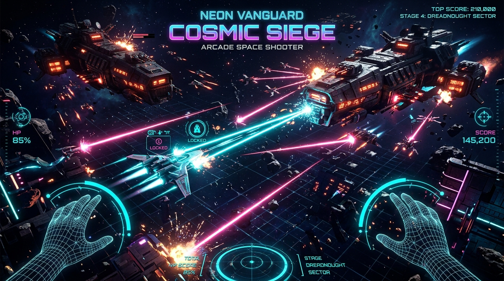
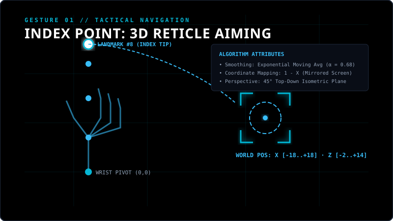
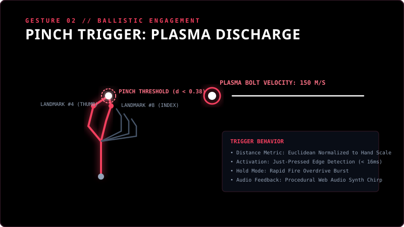
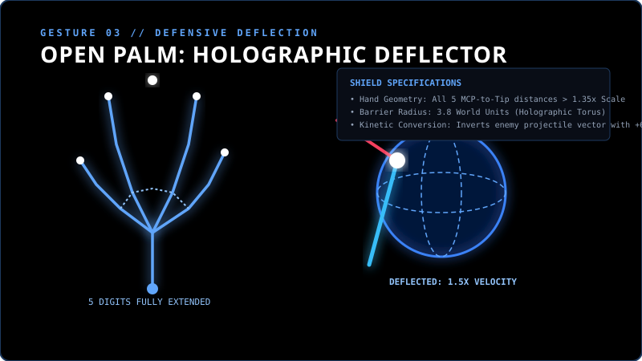
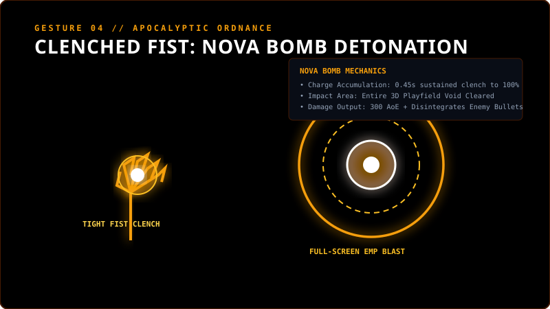

# GestureStrike 3D: Optical Hand-Tracking Arcade Defender

<div align="center">



[](https://www.typescriptlang.org/)
[](https://react.dev/)
[](https://threejs.org/)
[](https://developers.google.com/mediapipe)
[](https://vitejs.dev/)
[](LICENSE)

**A high-performance, real-time 3D arcade sector-defense shooter controlled entirely through computer vision and natural hand gestures.**

[Features](#-key-features) • [Gesture Guide](#-gesture-controls--attributes) • [Architecture](#-technical-architecture) • [Quick Start](#-quick-start) • [Controls](#-complete-control-matrix)

</div>

---

## 🌌 Overview

**GestureStrike 3D** merges cutting-edge in-browser machine learning with high-fidelity WebGL graphics. Set from an elevated **45-degree isometric perspective**, players command an advanced cybernetic interceptor defending space sectors from colossal enemy warships and wandering asteroid hazards.

By leveraging **MediaPipe Tasks Vision**, the game tracks 21 three-dimensional skeletal hand landmarks in real time directly through your standard webcam. Pointing your finger directs the 3D laser targeting reticle, pinching your thumb and index triggers plasma railgun discharges, spreading an open palm erects a 3D holographic deflector shield, and clenching your fist detonates an apocalyptic full-screen Nova Bomb.

---

## ✨ Key Features

- **🎯 True 45° Top-Down Isometric Perspective**: Engineered for optimal situational awareness and spatial depth. The 45-degree angle ensures smooth hand-to-flight coordinate translation across horizontal and vertical flight corridors.
- **👁️ On-Demand Camera Power Switch**: Complete privacy control. The webcam is **OFF by default** and can be powered on or off anytime with a single click or keyboard shortcut (`C`), seamlessly defaulting to mouse and touch controls when inactive.
- **🤖 21-Point Skeletal Hand Tracking**: Powered by MediaPipe Vision running via WebAssembly and WebGL GPU acceleration with adaptive luminance equalization for dim room environments.
- **🛸 Procedural 3D Starships & Colossal Bosses**: Fully composite 3–12 part hierarchical models (`THREE.Group`) built with PBR metals, roughness differentiation, and zero external 3D asset dependencies.
- **🪐 Destructible Asteroid Obstacles**: Faceted procedural asteroids drift across the battlefield with crystal mineral veins that shatter under concentrated fire into score and powerup shards.
- **🛡️ Kinetic Deflector Shield**: Raise an open palm to reflect incoming enemy laser curtains back into enemy hulls with a 1.5× velocity multiplier and bonus damage.
- **💥 Apocalyptic Nova Bomb**: Clench a tight fist to charge the antimatter core and unleash an expanding EMP shockwave that wipes out entire enemy swarms.
- **🔊 Procedural Web Audio Synthesizer**: 100% procedurally synthesized laser crackles, sub-bass explosion rumbles, harmonic combo pitch shifts, and shield chimes generated directly via the Web Audio API without external audio files.

---

## 🖐️ Gesture Controls & Attributes

### 1. Point to 3D Aim



- **Landmark Tracked**: Primary Index Fingertip (`Landmark #8`) and Wrist Pivot (`Landmark #0`).
- **Mathematical Transformation**:
  $$\text{aimX} = (1 - X_{\text{raw}}) \cdot \text{Bounds}_X$$
  $$\text{aimZ} = \text{Offset}_Z + (Y_{\text{raw}} - 0.5) \cdot \text{Bounds}_Z$$
- **Jitter Reduction**: Uses an **Exponential Moving Average (EMA)** smoothing filter ($\alpha = 0.68$) with velocity extrapolation to deliver zero-latency responsiveness while eliminating sensor noise.
- **Attribute**: Automatically computes wrist roll angle ($\theta_{\text{roll}}$) to physically bank the ship's wings when you tilt your hand.

---

### 2. Pinch to Shoot (Plasma Railgun)



- **Landmarks Tracked**: Thumb Tip (`Landmark #4`) and Index Tip (`Landmark #8`).
- **Trigger Condition**:
  $$D_{\text{pinch}} = \frac{\sqrt{(x_4 - x_8)^2 + (y_4 - y_8)^2 + (z_4 - z_8)^2}}{\|\text{Wrist} - \text{MCP}_9\|} < 0.38$$
- **Behavior**:
  - **Single Pinch**: Fires instantaneous high-velocity plasma bolts (150 m/s).
  - **Sustained Pinch**: Triggers rapid-fire continuous bursts when Overdrive buffs are acquired.
  - **Edge-Triggered**: Built with sub-frame input buffering and coyote timing so rapid taps never drop a shot.

---

### 3. Open Palm to Holographic Deflector Shield



- **Landmarks Tracked**: All 5 fingertips (`#4, #8, #12, #16, #20`) relative to MCP knuckle joints.
- **Trigger Condition**:
  $$\forall i \in \{8, 12, 16, 20\}, \quad \|\text{Tip}_i - \text{Wrist}\| > 1.35 \cdot S_{\text{hand}}$$
- **Deflection Mechanics**:
  - Projects a rotating 3D holographic energy sphere around your ship ($R = 3.8$).
  - When enemy projectiles hit the barrier, their velocity vector is inverted ($V_z = -1.5 \cdot |V_z|$) and their damage is amplified to **+75 Dmg** directed at enemy ships.

---

### 4. Clenched Fist to Nova Bomb



- **Landmarks Tracked**: All 4 finger tips curled inward close to the wrist and palm center.
- **Trigger Condition**:
  $$\forall i \in \{8, 12, 16, 20\}, \quad \|\text{Tip}_i - \text{Wrist}\| < 1.05 \cdot S_{\text{hand}}$$
- **Execution**:
  - Holding a clenched fist charges the Nova Ring from $0\% \to 100\%$ over **0.45 seconds**.
  - Releasing or reaching full charge detonates an expanding **300-unit EMP shockwave** that disintegrates all enemy bullets and inflicts 300 AoE damage across the entire sector.

---

## 🎮 Complete Control Matrix

| Action | Hand Gesture | Keyboard / Mouse Equivalent |
| :--- | :--- | :--- |
| **3D Aim & Move** | Point Index Finger (`#8`) | Move Mouse / Touch Pointer |
| **Primary Fire** | Pinch Thumb & Index (`#4` + `#8`) | Left Click / `Space` |
| **Deflector Shield** | Open Palm (All 5 Fingers Spread) | Hold `Shift` / Auto-Deflect |
| **Nova Bomb** | Clench Tight Fist (Hold 0.45s) | Click Nova Button / `B` / `N` |
| **Finger Gun Shot** | Extend Index, Flick Thumb | Left Click |
| **Camera Power** | Toggle in UI / Hotkey `C` | Press `C` (On / Off) |
| **Pause Mission** | — | `Escape` |
| **Mute Audio** | — | `M` |

---

## 🛠️ Technical Architecture

```
                                  ┌────────────────────────┐
                                  │   User Webcam Stream   │
                                  └───────────┬────────────┘
                                              │ (640x480 @ 60fps)
                                              ▼
┌────────────────────────┐        ┌────────────────────────┐
│  Fallback Pixel Luma   │◄───────┤ MediaPipe Tasks Vision │
│  & Skin Contrast Engine│        │  HandLandmarker (WASM) │
└───────────┬────────────┘        └───────────┬────────────┘
            │                                 │
            │  21 3D Landmarks & Gestures     │
            └───────────────┬─────────────────┘
                            ▼
               ┌────────────────────────┐
               │  GestureDetector Core  │
               │  (EMA Filter α = 0.68) │
               └────────────┬───────────┘
                            │ Real-time Telemetry (X, Z, Pinch, Fist)
                            ▼
               ┌────────────────────────┐
               │  GameEngine3D Loop     │
               │  (60fps Clamped Δt)    │
               └────────────┬───────────┘
                            │
        ┌───────────────────┼───────────────────┐
        ▼                   ▼                   ▼
┌──────────────┐    ┌──────────────┐    ┌──────────────┐
│ Three.js r174│    │ Procedural   │    │ Low-Occlusion│
│ 45° Renderer │    │ Web Audio    │    │ React 19 HUD │
│ PBR Materials│    │ Synthesizer  │    │ Zero-Box UI  │
└──────────────┘    └──────────────┘    └──────────────┘
```

### Engineering Highlights

1. **Isolated WebGL Lifecycle**: The `<canvas>` is mounted inside an isolated container outside of React re-render passes. Game physics updates run on a deterministic requestAnimationFrame loop decoupled from UI state.
2. **Software-WebGL Guard**: Detects software WebGL drivers (SwiftShader, llvmpipe) via `WEBGL_debug_renderer_info` to adjust pixel ratio and shadow maps automatically, guaranteeing smooth execution on all hardware.
3. **PBR Environment Reflections**: Employs Three.js `RoomEnvironment` through a `PMREMGenerator` for authentic metallic reflections across brushed gunmetal hulls and chrome cannon barrels without external cubemaps.
4. **Hitstop & Screen Trauma Decay**: High-impact collisions induce a brief 40–80ms simulation freeze (hitstop) paired with quadratic rotational camera shake trauma ($\text{Offset} \propto \text{Trauma}^2$) for visceral arcade weight.

---

## 👾 Enemy Fleet & Obstacles

| Unit | Type | Scale | Threat Level | Tactical Profile |
| :--- | :--- | :--- | :--- | :--- |
| **Scout Drone** | Lightweight Recon | 2.4× | Medium | Swift lateral zigzags firing twin high-speed laser salvos. |
| **Corrupted Core** | Spiked Space Mine | 2.6× | High | Detonates in a lethal 5-way spiraling shrapnel barrage. |
| **Void Striker** | Heavy Gunship | 2.6× | Severe | Long-range sniper attacks with targeted laser beam telegraphs. |
| **Asteroid** | Environmental Obstacle | 2.5× | Environmental | Faceted low-poly space rock with destructible mineral veins. |
| **Titan Dreadnought** | Capital Boss | 2.8× | Extreme | Multi-phase warship with rotating magnetic shields and 7-way curtains. |

---

## 🚀 Quick Start

### Prerequisites

- [Node.js](https://nodejs.org/) (version 18.0 or higher)
- [npm](https://www.npmjs.com/) or [pnpm](https://pnpm.io/)
- A webcam for optical gesture tracking (optional; full mouse/touch supported)

### Installation

```bash
# Clone the repository
git clone https://github.com/ax1nd/Gesture-Strike.git

# Enter project directory
cd Gesture-Strike

# Install dependencies
npm install

# Launch development server
npm run dev
```

Open your browser at `http://localhost:3000` to play.

### Production Build

```bash
# Compile and optimize production bundle
npm run build

# Preview production build locally
npm run preview
```

---

## 🔒 Privacy & Permissions

- **Zero Remote Video Transmission**: All camera image processing and hand pose inference execute **100% locally** on your device inside client-side WebAssembly / WebGL. No video frames, screenshots, or camera data ever leave your browser.
- **Camera Power Controls**: You can toggle the camera on or off at any moment using the in-game HUD switch or the `C` hotkey.

---

## 📜 License

Licensed under the Apache License, Version 2.0 (the "License"). See [LICENSE](LICENSE) for details.

---

<div align="center">
Built with ⚡ by <b>ax1nd</b>
</div>
